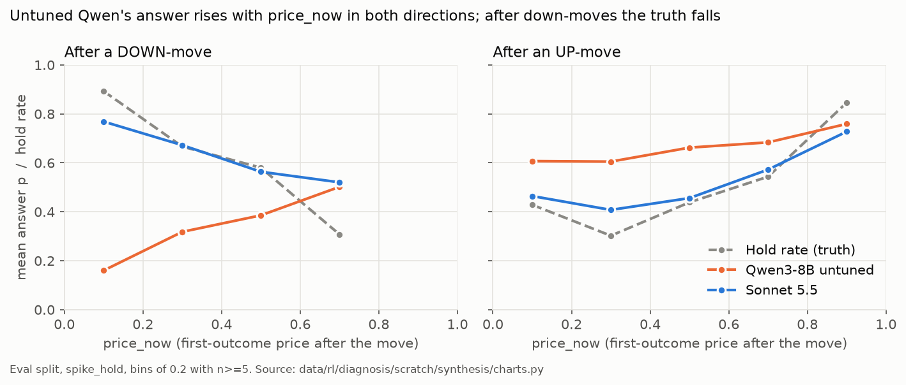
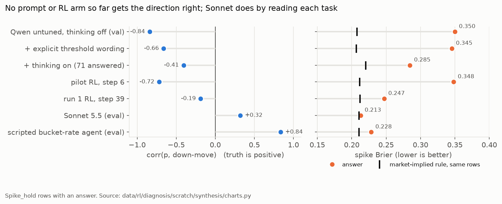
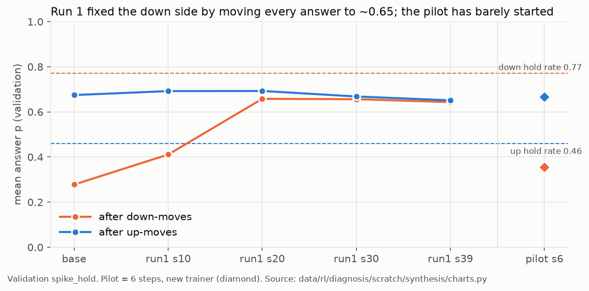

# M15 diagnosis: why Qwen3-8B reads spike direction backwards, and why RL does not fix it

Date 2026-10-13. Analysis only; nothing here changes code, data or plans. Sources: seven investigations, each adversarially verified (scripts and outputs under `data/rl/diagnosis/scratch/<aspect>/` and `scratch/verify-<aspect>/`), the lead's two paid probes (`experiments/m15_diagnosis/probe.py` → `data/rl/diagnosis/probes/`), and the synthesis scripts in `data/rl/diagnosis/scratch/synthesis/` (`charts.py` → `charts.out`, plus `think_fallback.py`, `summary_penalty.py`, `pilot_spread.py`), and a critic's offline checks (`scratch/critic/c1`–`c3`). Only confirmed or partly-confirmed findings are used. Where a finding was only partly confirmed, the corrected reading is the one given here. Review notes are at the end.

## 1. Bottom line

1. The labels, tools and data are correct. Moves *down* really do hold more often than moves *up* (train 0.72 vs 0.48). About half of that gap comes from down-moves landing near 0. The rest is *consistent with* "Yes" markets drifting down over time; how big that part is depends on the sampler (−1.7 vs −0.2 points, labels-data-3 verifier). The model's down offset does not follow this drift: it is the same in markets whose first outcome is not "Yes" (−0.26 vs −0.27, `critic/c2.py`).
2. Untuned Qwen answers with two habits instead of reading the task. It anchors on the current price (p rises with price_now in both directions), and it takes a further ~0.27 off every down-move. Together these explain 82% of the variance in its answers (R²). After a drop, both habits point the wrong way. The same structure appears at training temperature 1.0 (R² 0.90 on step-0 rollouts, `critic/c2.py`).
3. The thinking-on traces suggest a mechanism, but only one piece of it is direction-specific. In 10 of 25 down-move traces the model misreads "half the move still there" after a drop, against about 2 of 46 up-moves; one labeller could see p. The other habits it shows (expecting a rebound, saying the tools give no forecast, then falling back to the current price) are just as common after up-moves. So they explain the price anchor, not the down offset. It never names the 0.50 launch placeholder that Sonnet uses: 0 of 90 recently-launched tasks with thinking off, 0 of 13 with thinking on.
4. RL's reward points the right way on down-moves. But the model's samples barely vary along the rule it needs (answer ≈ 1 − price_now after a drop), so the reward can only say "higher" or "lower". Run 1 moved every answer to one constant (0.65). The pilot has not collapsed (validation sd 0.214, against 0.233 at base). Its improvement in direction corr is small but significant (+0.11, CI [0.03, 0.20]). Run 1's step 10 was not significant (CI [−0.01, 0.10], `critic/c1.py`).
5. A large share of the penalty is self-inflicted and free to fix. The answer tool asks for a summary "without numbers" (agent.py:63), but 389 of 390 base_eval summaries contain one, and the verifier drops each one (agent.py:204). Without that, about 17% of base_eval spike answers would be penalised instead of 64% (`synthesis/summary_penalty.py`).
6. Fix the starting point before spending on RL. Cheap prompt A/Bs come first, then a reasoning-capture run, then a short SFT warm start, then a guarded RL run. The realistic target is to match the market-implied rule (spike Brier ≈ 0.21), not to beat it by much.

## 2. Causal chain

| # | Link | What happens | Evidence strength |
|---|---|---|---|
| 1 | **Inputs** | The prompt calls every price "a probability of the first outcome" (agent.py:90), shows a signed move, and gives `probability` no stated subject (agent.py:62-68). Thinking is off (config.py:38). Labels, facts and tools are correct for both directions. | Code facts certain. Their *causal* role is weak: spelling out the threshold changed little (§3.1). |
| 2 | **Model prior** | p ≈ 0.44 + 0.42·price_now − 0.27·down (R² 0.82). The price anchor causes the headroom sign. The down offset is a separate habit (direction alone R² 0.66 > price alone 0.51). The thinking-on traces show only one direction-specific mechanism: the drop event is misread (10/25 down vs ~2/46 up). Rebound talk and the fall-back to the current price appear in both directions, so they fit the anchor. | Description: **strong** (it holds at T = 1.0 and in non-Yes markets). Mechanism: **weak to medium** (one sample per task at T = 0.7, 25 answered down-moves; thinking-off writes no text). |
| 3 | **Answers** | 75% of base Qwen's excess Brier over the market comes from down-moves ending at price_now ≤ 0.3 (22% of rows), where 79-94% of moves hold and Qwen answers 0.10-0.26. Its answers add nothing beyond the market price. | **Strong** |
| 4 | **Reward** | Outcome Brier pushes down-move answers up (28/35 pilot groups correct-signed). The up-side pull is 2.5× weaker (SNR per group 0.36 vs 1.04). The 0.25 penalty is about half of within-group reward variance, mostly from numbers in the summary (bottom line 5), but does not change the push on p. Open: the answer's digits get ~0.2% of the token weight (`training-audit/token_share.json`), so the effective step on them may be too small on the up side. | **Strong** for the sign; **medium** for what it implies |
| 5 | **Training** | Within-group spread of p is about 0.09, centred on the anchored answer, so almost no sample looks like "1 − price_now" (5.6% of held down-move samples > 0.5). RL can shift the level but not learn the rule. Run 1 shifted everything to 0.65 (sd 0.23 → 0.02, resolution → 0) and dropped hist_market/hist_siblings. The pilot is not yet collapsing (sd 0.214) and moved down answers +0.07 in 6 steps. | **Strong** for run 1; **open** for the pilot |
| 6 | **Ceiling** | A facts-only logistic fit on 4,000 train tasks does no better than the market-implied rule on eval (0.210 vs 0.2105). Sonnet scores 0.213. | **Strong** |

## 3. Evidence by layer

Headline numbers per run (spike_hold rows with an answer; `scratch/synthesis/charts.out`):

| run | n | Brier | Brier if down p→1−p | market rule | best const | dir corr | corr(p, price_now) | mean p up / down | hold up / down |
|---|---|---|---|---|---|---|---|---|---|
| base_eval | 390 | 0.345 | **0.238** | 0.210 | 0.243 | −0.81 | +0.72 | 0.67 / 0.32 | 0.49 / 0.66 |
| frontier_eval (Sonnet) | 400 | 0.213 | 0.336 | 0.211 | 0.242 | +0.32 | −0.15 | 0.51 / 0.65 | 0.50 / 0.66 |
| tuned39_eval | 400 | 0.246 | 0.298 | 0.211 | 0.242 | −0.02 | +0.10 | 0.65 / 0.65 | 0.50 / 0.66 |
| base_validation | 146 | 0.350 | **0.236** | 0.207 | 0.242 | −0.84 | +0.70 | 0.67 / 0.28 | 0.46 / 0.77 |
| run1 step 10 / 20 / 39 (val) | 150 | 0.323 / 0.253 / 0.247 | | 0.212 | 0.242 | −0.80 / −0.36 / −0.19 | +0.66 / +0.35 / +0.19 | 0.69 / 0.41 → 0.65 / 0.64 | 0.45 / 0.77 |
| pilot step 6 (val) | 149 | 0.348 | 0.262 | 0.212 | 0.243 | −0.72 | +0.61 | 0.67 / 0.36 | 0.45 / 0.77 |
| probe: think_on_80 | 71 | 0.285 | 0.255 | 0.220 | 0.250 | −0.41 | +0.39 | 0.59 / 0.45 | 0.41 / 0.72 |
| probe: explicit_off | 148 | 0.345 | 0.311 | 0.207 | 0.242 | −0.66 | +0.60 | 0.75 / 0.46 | 0.45 / 0.77 |

### 3.1 Inputs and prompt framing
- **The labels are right.** Recomputing all 4,550 spike tasks from `hist_prices` gives 0 mismatches in price_before, price_now and y (`verify-labels-data/recompute.py`). retained = (later − base)/move (tasks.py:115) is correct for both signs. There is one tiny defect: 6 tasks with retained exactly 0.5 are labelled 0 because of float rounding (0.13% noise; `verify-labels-data/extra.py`).
- **The tools agree with the prompt.** hist.move matches the prompt's price and sign in every saved episode (`verify-tools-inputs/v1.py`). Nothing reads past as_of.
- **The framing is a contributing factor at most.** With thinking off, Qwen writes text in only 6 of 965 turns (explicit_off), so nothing translates the question into a price threshold before the answer. But supplying the threshold in the prompt (explicit_off) left dir corr at −0.66 and spike Brier at 0.345. Down answers rose (0.28 → 0.46), and up answers rose too (0.68 → 0.75).
- **Thinking roughly halves the direction error but does not remove it.** On 69 matched tasks direction corr goes from −0.82 to −0.38 (CI of the change [0.25, 0.66], `critic/c1.py`). This rests on one sample per task at temperature 0.7, with only 25 answered down-moves.

### 3.2 Model prior: two habits, not one
- On base_eval, p ~ price_now + down gives coefficients 0.439 / +0.417 / −0.265, R² 0.815. Price alone gives 0.51; direction alone gives 0.66 (`verify-prompt-framing/v1.py`). Within down-moves the answer moves the wrong way with price: p = 0.12 + 0.59·price_now, while the truth is y = 0.97 − 0.90·price_now. Within up-moves the sign is right but the slope is too flat (0.23 vs 0.75), and every up answer is ≥ 0.35.
- **Price anchoring explains the headroom sign but not direction.** On down-moves headroom equals price_now, so corr(p, headroom | down) = +0.78 while corr(y, headroom | down) = −0.38. The down offset survives controlling for price (partial corr −0.71).
- **Resolve tasks copy the price 100% of the time** (198/198). That is Qwen's default meaning of "probability". It is not specific to Qwen: Sonnet's resolve p correlates 0.997 with price_now.

### 3.3 Reasoning (summaries with thinking off, traces with thinking on)
- **Summaries treat the move as sentiment.** Sentiment words appear in 74%/80% of base up/down summaries, against 1%/0% for Sonnet. Down summaries that argue the move will be retained still give p < 0.5 in 67 of 71 cases, and those tasks held 75% of the time (`verify-rationale-reading/v5.py`). Example, base_eval `spike_hold:0x4ae744540f…` (0.50 → 0.0535, y = 1):
  > Qwen, p = 0.05: "it is unlikely that a significant portion of this drop will reverse within the next 72 hours. Therefore, I estimate the probability that at least half of this move is still present 72 hours later to be around 5%."
  > Sonnet, p = 0.97: "The 0.5 price was a placeholder from just after the market launched. It then fell to a realistic outright-winner price of about 5%, in line with the other golfers. For half the move to reverse, Fleetwood would need to be above about 28%…"
- **With thinking on, the drop event is misread. This is the only direction-specific evidence**, and it comes from one labeller who could see p. In 10 of 25 answered down-move traces, "half the move still there" becomes "the price falls another half-move" or the wrong side of the midpoint. Only 2 of 25 state the correct threshold; for up-moves, about 2 of 46 get it wrong (`verify-prompt-framing/think_labels.md`). Example, `spike_hold:0x62593e7f…` (0.55 → 0.40): *"at least half of this move (so, -7.5 points) remains after 72 hours, meaning the price would be at 0.4 - 7.5 = 0.325 or lower."*
- **With thinking on, the model falls back to the price in both directions** (one regex set, `synthesis/think_fallback.py`). Rebound words (rebound, bounce, recover, revers) appear in 29/29 down and 49/51 up traces. Statements that the tools give no forecast appear in 24/29 and 35/51. Those statements are often true, so calling them "giving up on the tools" is an interpretation. "Based on the current price" appears in 14/29 and 18/51. None of these depend on direction, so they explain the anchor, not the down offset. (The labels-data-5 verifier used a different rebound regex and got 0.90 / 0.59.) Example, `spike_hold:0x04fe95ce…`: *"The probability … is estimated to be 0.405, based on the current price and the trend"* (price_now 0.405, y = 1).
- **Sonnet's correct direction comes from reading each task, not from a rule.** Price_now plus direction explain only R² 0.10 of its answers. It names launch placeholders on 73% of the recently-launched tasks. Thinking-off Qwen names them on 0 of 90, even though it called hist_market (which returns start_at) on 389/390 tasks. Thinking-on Qwen names them on 0 of 13 placeholder tasks (6 down-moves, `critic/c3.py`), a much weaker result. On recently-launched down-moves Qwen's mean p is 0.21 and Sonnet's is 0.77, with hold rate about 0.76.

### 3.4 Answers versus the truth
- 43% + 32% of base_eval's excess Brier comes from down-moves ending at price_now ≤ 0.1 (n = 32, hold 0.94, mean p 0.105) and 0.1-0.3 (n = 56, hold 0.79, mean p 0.26) (`verify-labels-data/model_cells.py`).
- Qwen's answers add nothing to the market price. In 5-fold cluster CV, market + direction scores 0.206 and adding Qwen's p gives 0.209. Its within-direction AUC is 0.34 on down-moves (`verify-statistics/v3.py`).
- **Placeholder subset** (price_before ≈ 0.50): it holds 0.86 down and 0.69 up on train. It carries 18% of squared error from 11.5% of rows. But dropping it barely changes dir corr (−0.81 → −0.80), so it is an expensive subgroup, not a separate cause.

### 3.5 Reward and training

- **Run 1 learned a constant.** By step 39, 55/61 down and 84/85 up validation answers are 0.65. sd(p) fell 0.233 → 0.021, and step 39 (0.247) is worse than the best constant (0.2425). All of its gain came from down-moves (summed Brier −15.9, against +0.9 on up-moves). It stopped calling hist_market and hist_siblings (1/400 each on eval, against 389/386 of 390 in base).
- **The pilot signal is correct-signed but carries no conditional information.** Signed corr(advantage, p) toward the truth is +0.63. 26 of 35 down groups held, so the push says "answer higher after down-moves", not "answer 1 − price_now". Validation down answers rose by a paired +0.070 (se 0.022) in 6 steps, about run 1's pace, while training-rollout down mean p did not trend (0.30 → 0.30). The two are compatible: each step trains on only 5–7 different down tasks (`synthesis/pilot_spread.py`), so per-step training means are noisy and are not comparable from step to step.
- **The samples lack the right answers.** Of rollouts on down-moves that held, 5.6% answered > 0.5 (p90 = 0.45). Within-group sd is 0.084-0.097 in every direction × outcome cell.
- **The up side is weak by construction.** The expected pull per group is −2(p̄ − P)·Var(p): +0.90·Var on down-moves against −0.36·Var on up-moves. The toy's up side stalls at 0.53-0.73 even with about 1,600 up groups, so the stall comes from weak pull plus collapsing Var, not from outcome noise.
- **Penalty and malformed answers add noise.** The penalty is mostly verifier-dropped claims, not the tool budget, and most of those are the summary itself. 389/390 base_eval and 149/149 pilot-step-6 summaries state a number against the instruction (agent.py:63) and are dropped (agent.py:204). With clean summaries the penalised share would fall from 64% to 17% (base_eval) and from 52% to 7% (pilot), holding the other claims fixed (`synthesis/summary_penalty.py`). The penalty is about half of answered within-group variance, is uncorrelated with p (−0.04 / +0.05), and leaves the push on p unchanged when removed (down +12.8 vs +13.5). Malformed answers (4.9%) are the bigger variance source. Resolve groups have zero spread in p, so they train only on penalty avoidance.

## 4. Ruled out

| Hypothesis | Verdict and evidence |
|---|---|
| Label, sign or look-ahead bug | 0 mismatches across 4,550 tasks; tool and prompt agree 100% on price and sign |
| Labels mostly reflect resolution, not retention | 91.7% of t+72h prices lie in (0.02, 0.98); the gap stays (0.69 vs 0.48) with near-settled cases excluded |
| Split drift, category, neg_risk, a few events | The gap appears in every split, category and neg_risk value; clusters hold at most 3 tasks |
| Qwen substitutes "will the first outcome win" | Refuted: partial corr(p, first-outcome-wins given price_now) ≈ 0; think traces talk about a rebound (most) far more than about winning (24%) |
| Literal misreading of the question as P(YES) | No summary does this, but a *direction-specific* misreading of the event exists (§3.3) |
| A missing translation step is the main cause | Supplying the threshold (explicit_off) left dir corr at −0.66 |
| Tool output causes the wrong-way answers | The direction gap is the same in every tool sequence, with and without errors or budget cuts; buy_share is ~0.83 in both directions but rarely cited (it is a tool weakness, not a cause) |
| Context spill-over between tasks | Each episode opens a fresh session |
| Penalty swamps the forecasting gradient | Refuted: removing the penalty leaves the push on p the same. It is noise, not bias, and most of it comes from numbers in the summary (§3.5) |
| LR too small *on the down side*, wrong-signed advantages, length bias, GRPO-variant issues | Run 1 moved down-move answers +0.38 at the same LR; advantages are correct-signed; corr(A, tokens) ≈ 0.1; one on-policy step per batch and no degenerate groups, so clip/DAPO/GSPO fixes do not apply. **Not ruled out:** the effective step on the answer digits is too small on the up side (LR × token dilution, digits ≈ 0.2% of weight, `training-audit/token_share.json`); see P0 |
| Sampling temperature | Step-0 pilot rollouts (untuned, T = 1.0) show the same structure: p = 0.40 + 0.50·price_now − 0.25·down, R² 0.90, direction corr −0.88 (`critic/c2.py`) |
| "Yes" framing / outcome-token valence | Markets whose first outcome is not "Yes" (Over, team names) get the same down offset: −0.258 vs −0.271, direction corr −0.89 vs −0.79 (n 112 / 276, `critic/c2.py`). The offset follows the sign of the move |
| Parsing of p (% vs fraction, sign flips) | Every summary that states a percentage agrees with the parsed p within 0.01: 161/161 base_eval, 61/61 base_validation, 75/75 pilot (`critic/c1.py`) |
| (Not checked) neg_risk on the model side | neg_risk is not in the transcripts. On the data side the gap appears at every neg_risk value; exact-score markets are 0.3% of down-moves |
| Too few labels to learn from | A 3-parameter logistic learns the right sign from 66 labels (Brier 0.221) |
| Resolve tasks hide a second problem | Resolve copies the price, so its Brier equals the market's |

## 5. What the missing raw reasoning would settle

The probes captured thinking-on text. Thinking-off runs (all training and all evals) contain no model text. A capture run would settle:

1. **Emission order.** Is `probability` emitted before `summary`? If so, every thinking-off summary is a rationalisation written after the number, and the 67/71 "argues retention, answers low" cases are not reasoning failures.
2. **Whether thinking-off makes the same errors as thinking-on.** Does it carry the same drop misreading and the same "no forecast data → current price" fallback? Thinking-on is our only window, and it reduces the error by half, so it may not be representative.
3. **Up-move inflation (+0.12 to +0.16 above price_now).** Momentum belief or a template answer (0.65)?
4. **Whether RL rollouts ever contain the placeholder or sibling reading.** train_rollouts.jsonl stores no text. If the reading never appears, RL from this start cannot reinforce it.
5. **Whether `start_at` and the sibling list are read at all**, or fetched and ignored.

## 6. Fine-tuning methods: literature and fit here

| Method | What the literature says | Fit here |
|---|---|---|
| More on-policy RL (GRPO-style) from base | RLVR mostly sharpens behaviour already in the base distribution (Yue et al., arXiv 2504.13837). Forecasting RL gains are modest and slow: Cookbook recipe 512 episodes × 100 steps for +0.024 Brier reward; Turtel et al. 14B 0.215 → 0.199 on 10k questions | **Poor first move.** Samples lack the rule; ~$1.85/step; the down side alone needs about 39 steps (≈ $72) at the pilot's pace |
| SFT warm start, then RL | Standard route for new behaviour; the on-policy distillation post starts RL from an SFT checkpoint; Turtel warns that multiple epochs overfit | **Best fit.** Cross-entropy moves the answer directly. Risk: copying a target leaves zero within-group spread (as resolve shows today), so RL afterwards needs spread kept |
| SFT target: market-implied q (scripted, free generation) | Calibrated reference (val 0.212 / eval 0.2105); no API cost | Cheap but caps the model at about q. Needs a new q-policy and templated, receipt-citing summaries, and teaches a 2-call tool pattern |
| SFT target: Sonnet transcripts on train tasks, filtered by Brier | Distillation of reasoning style | Teaches the actual reading (placeholder, siblings, threshold). ~$0.023/task. Sonnet also makes sign errors, so filter |
| On-policy distillation | Needs teacher per-token logprobs; ~10× cheaper than RL | Sonnet cannot be the teacher; an open-weight teacher must first be shown not to share the prior |
| RFT / STaR / DPO on self-samples | Bounded by the sampled support | Only 4.2% of down samples ≥ 0.6, so too little to select from |
| Thinking on during RL | Every forecasting-RL precedent reasons first; Cookbook tool-use recipes do train thinking-off | One probe (n = 71, T = 0.7, not the training temperature) roughly halved the direction error at ~1.34× cost per episode, with 11% malformed. Worth testing at T = 1.0 (P2) before relying on it |
| Reward shaping: target q in place of y (warm-up), mask malformed, smaller penalty | E[(p−y)²] = (p−P)² + const, so q removes outcome noise; RLCR (arXiv 2507.16806): Brier terms help calibration | Hygiene. It does not fix the weak up-side pull or Var collapse, and the bucket target caps at 0.219 |
| Entropy 0.1 | Turtel uses 0.001 | Reduce to ≤ 0.01, or use KL-to-base 0.02, once the start is fixed |

## 7. Recommended plan (≈ $73–80 total; P1 + P2 ≈ $3.0 fit the ≈ $3 Phase 4 remainder)

Costs come from measured runs: base_validation thinking-off full tools $0.92 per 150 spike tasks; think_on_80 $0.0083 per episode; pilot $1.85 per step. Single-turn, no-tool calls cost ≈ $0.2 per arm for 4 samples × 150 tasks ($0.195/M prefill, $0.60/M sampling); C costs more. Every gate is measured on validation spike tasks and reported **per direction**: paired up and down shifts, within-direction corr(p, y), corr(p, headroom) < 0, sd(p), and Brier against the market rule on the same rows. Placeholder and non-placeholder tasks are split. Changes to tool output, prompt facts or reward need a DECISIONS.md line and a stop for review (rule 5).

| # | Experiment | Tests | Cost | Pass / fail |
|---|---|---|---|---|
| P0 | **Offline, free.** (a) Toy: add the verifier penalty, resolve groups, price anchoring and a target-q reward; report the up mean *and* within-group Var. (b) Recompute pilot advantages with malformed answers masked. (c) **Per-token credit:** from the pilot rollouts, recompute the advantage-weighted share of the loss on the probability digits under the current length normalisation (×4 answer turn), and the effective step that implies per direction. (d) Rate of Sonnet sign errors (threshold stated on the wrong side of the midpoint) in the 400 frontier_eval transcripts, to size P4. (e) Add per-direction and placeholder splits to the diagnose output (not committed until approved). | Whether noise, Var collapse or digit dilution blocks the up side; P4 yield | $0 | Informs P4–P5 settings only |
| P1 | **Prompt A/B, single turn, no tools**, 150 val spike tasks, thinking off, 4 samples. Arms: **A** as now. **B** down-moves mirrored to up-moves of the other outcome. **B′** reverse mirror: up-moves restated as down-moves of the other outcome. **C** a `reasoning` field before `probability`. **D** the market-implied hold probability stated in the prompt. **E** without the sentence "Prices are probabilities of the first outcome" (agent.py:90). **F** unsigned wording ("fell by 10.2 points", not "−10.2 points"). Cut E first if money runs short. | B + B′: does the offset follow the *shown* sign (drop misreading) or the task? C: answer-first emission. D: can the model use a supplied number? E, F: wording | ≈ $1.4 | **B/B′:** fit p ~ shown price + shown-down on A ∪ B ∪ B′. Drop misreading predicts B′ answers go low (shown-down coefficient stays ≈ −0.27). Pure anchoring predicts B′ tracks the shown price, 1 − price_now. B counts as *better reading* only if its spike Brier beats what the base fit predicts for mirrored inputs (0.231 val, `critic/c1.py`); matching that is a mechanical framing gain, still usable. **D** passes if down answers come within 0.05 of q **and** repeated samples keep sd ≥ 0.05. **C, E, F** need tool confirmation (P3) before they inform the SFT framing |
| P2 | **Reasoning-capture run.** (i) Full tools, 150 val spike tasks, thinking off, current prompt, saving all raw sampled text (settles §5.1–5.2), ≈ $0.92. (ii) Thinking on with the best P1 arm, 8 samples × 10 down-move tasks at T = 1.0 (within-group spread at training temperature), ≈ $0.66 | §5 questions; whether thinking-on RL has spread worth training on | ≈ $1.6 | Pass for thinking-on RL: within-group sd ≥ 0.12 and ≥ 20% of samples on the correct side on down-moves |
| P3 | **Full-tool eval of the winning P1 arm(s)**, e.g. a mirrored tool wrapper or `price_is_for` naming the other outcome for B | Whether the P1 gain survives tool use | ≈ $1 per arm | Spike Brier ≤ 0.25 and dir corr > 0 |
| P4 | **SFT warm start.** P4a: ~400 Sonnet trajectories on *train* spike tasks. Keep every trajectory except malformed ones and sign errors (wrong side of the midpoint; rate from P0d). **No Brier filter**: it would keep lucky extremes and push towards overconfidence. Yield ≈ 400 × (1 − malformed − sign-error rate). LoRA SFT 1 epoch, LR ~2e-4 (≈ $10 sampling + ~$2 train + $1 eval). P4b, only if P4a fails or for comparison: scripted q-answer transcripts (≈ $4). Use the best P1/P3 framing in both. | Whether the reading (placeholder, siblings, threshold) can be taught to the model | ≈ $13–17 | Val dir corr > 0, spike Brier ≤ 0.23, sd(p) ≥ 0.12, within-direction corr(p, y) > 0; Brier and dir corr on the placeholder subset reported against the rest, and not worse than Sonnet's there; malformed + penalty rate not worse than base |
| P5 | **Guarded RL from the best start**, 10 steps: spike-only batches, malformed masked from the baseline, penalty 0.05, entropy ≤ 0.01 or KL-to-base 0.02, digit weighting per P0c, rollout summaries logged, renderer per P2. Checkpoints at steps 5 and 10. | Whether RL improves a prior that is right-signed | ≈ $21 | Keep a checkpoint only if Brier vs market improves **and** sd(p) and within-direction corr(p, y) do not fall below the start. Stop on collapse |
| P6 | Final eval on the frozen 1,872-task holdout | | ≈ $10 thinking off (1,872 × $0.0052); ≈ $13 thinking on | Spike Brier ≤ 0.22, dir corr > 0 |
| | **Contingency:** second P4/P5 attempt (e.g. thinking-on RL) | | ≈ $25 | |

Total: 0 + 1.4 + 1.6 + ~1 + 13–17 + 21 + 10–13 + 25 ≈ **$73–80**.

**What to expect.** The market-implied rule is the realistic ceiling (eval 0.2105; best facts-only fit 0.210, CI ±0.01). A success means matching it with the right per-direction structure. If P1-B or P1-D already brings spike Brier to about 0.22, the cheapest finished product may be the framing change plus a short SFT, with RL optional.

**Decisions for the user.** (1) Approve P1–P2 (≈ $3.0, the Phase 4 remainder). (2) Mirroring or showing q changes the task inputs (rule 5): approve before P3. (3) The summary penalty (bottom line 5) can be fixed for free, either by stripping numbers from the summary before verification or by not verifying the summary as a claim. It changes the reward, so it needs approval before P4/P5. (4) Is beating the market a goal for M15, or is matching it with correct structure enough?

## Review notes (critic, 2026-10-13)

All 16 points were checked against the critic's scripts and outputs (`scratch/critic/c1`–`c3.out`) and applied. Notes:
- **Fix 15 (penalty) was stronger than stated.** The critic counted 161/390 summaries with a percentage. Counting any digit gives 389/390, and every one of them is dropped as "states a number without evidence". The counterfactual penalty rate is in `synthesis/summary_penalty.py`.
- **Fix 7.** Confirmed with `synthesis/pilot_spread.py`: validation sd(p) 0.233 → 0.214 (pilot) against 0.174 at run 1 step 10, and 5–7 different down tasks per training step.
- **Fix 13.** Accepted. With arms B′, E and F added, P1 + P2 ≈ $3.0 rather than the critic's $2.4–2.8, because E is restored too. E is the first arm to cut.
- **Fix 6.** The rebound count now uses one regex (`think_fallback.py`); the verifier's 0.90 / 0.59 is noted, not used.
- No fix rejected.

## 8. Phase 4 results: P1 and P2 run (2026-10-13 evening, validation only, $3.51 in total)

Added after the synthesis. Scripts: `experiments/m15_diagnosis/p1_framing.py` (P1) and `probe.py` (P2). Outputs: `data/rl/diagnosis/p1/` and `data/rl/diagnosis/probes/`.

### P1: prompt framing, single turn, no tools (150 val spike tasks × 8 samples, thinking off, T = 0.7, $0.32)

| arm | Brier | dir corr | mean p up / down | down corr(p, q) | within-task sd |
|---|---|---|---|---|---|
| market rule q | 0.212 | | 0.51 / 0.70 (q) | | |
| A: current wording | 0.311 | −0.64 | 0.79 / 0.59 | −0.59 | 0.049 |
| B: drops restated as rises of the other outcome | 0.278 | **+0.19** | 0.79 / 0.82 | **+0.57** | 0.037 |
| B′: rises restated as drops | 0.294 | −0.52 | 0.73 / 0.59 | −0.55 | 0.057 |
| C: `reasoning` before `probability` | 0.373 | −0.64 | 0.65 / 0.29 | −0.29 | 0.179 |
| D: q stated in the prompt | 0.245 | −0.29 | 0.66 / 0.60 | +0.49 | 0.038 |
| E: no "prices are probabilities…" sentence | 0.338 | −0.77 | 0.79 / 0.50 | −0.36 | 0.065 |
| F: unsigned wording | 0.313 | −0.73 | 0.73 / 0.51 | −0.37 | 0.053 |
| **BD: B and D together** | **0.226** | **+0.47** | 0.66 / 0.75 | **+0.67** | 0.034 |

Hold rates: 0.45 up, 0.77 down. Reading:
- **The shown sign explains little.** Fit over A ∪ B ∪ B′: p = 0.64 + 0.28·shown price − 0.10·shown-down (R² 0.48). The offset that follows the *shown* drop is −0.10, against −0.27 for the true drop with tools. Most of the effect is anchoring on the shown price plus a blanket "moves persist" prior (up answers 0.66–0.79 where 0.45 hold). The drop misreading (§3.3) is real but secondary.
- **Restating drops as rises (B) fixes the down side** (corr(p, q) −0.59 → +0.57). Adding q (BD) gets within 0.014 of the market rule with no training, and dir corr +0.47, above Sonnet's +0.32. Down Brier 0.170. The remaining loss is up-move inflation (up Brier 0.268).
- **A short reasoning field written first hurts (C)**, as does removing the price sentence (E). Unsigned wording (F) does nothing. D alone fails its gate (down answers 0.60 against q 0.70; sd 0.038 < 0.05).
- **Within-task spread is tiny with thinking off** (sd 0.03–0.06), so RL on any of these framings would start with almost no exploration, as in the pilot.

### P2(i): capture run, full tools, thinking off, current prompt (150 val spike tasks, $0.89)

- Same behaviour as base_validation: dir corr −0.84, spike Brier 0.344 (against 0.350).
- **The number comes first:** `probability` is the first key of `submit_answer` in 144 of 144 answers. Every thinking-off summary is written after the number (settles §5.1).
- **No model text:** 11 of 1,101 turns contain any text. The number is produced with no reasoning at all.
- Transcripts now keep model text, thinking, and the submit arguments in emission order (`gridcase/rl/agent.py`, `models.py`; new test `test_transcript_keeps_what_the_model_wrote`).

### P2(ii): thinking on, T = 1.0, 8 samples × 10 down-move tasks ($0.68)

- **Passes the thinking-on RL gate:** mean within-task sd 0.187 (gate 0.12), and 34% of samples on held down-moves are > 0.5 (gate 20%), against 5.6% in the thinking-off pilot rollouts.
- Malformed rate is 19% (out of tokens or tool budget). Brier on these 10 tasks is 0.273 against the market's 0.260 on the same rows.
- Implication: thinking-on gives RL the spread it lacks. The malformed rate must come down (more tokens, or a malformed mask in the baseline) before RL on it.

### What changes in the plan

1. **P3 (needs approval, rule 5): full-tool eval of BD**, with drops restated as rises of the other outcome (mirrored tool outputs, or `price_is_for` naming that outcome) plus q in the prompt. Thinking off and on. About $2.
2. **P4 SFT warm start** should use the BD framing. Its main job is now the up-move inflation and the reading of the series, not the down sign.
3. **P5 RL** should use thinking on (P2(ii) spread), mask malformed answers, and fix the summary penalty.
4. **Decision for the user:** BD hands the model the market's number. If the product goal is "match the market with the right structure", BD plus a short SFT may be enough. If the goal is to *beat* the market, q in the prompt sets a strong anchor that RL must learn to depart from.
